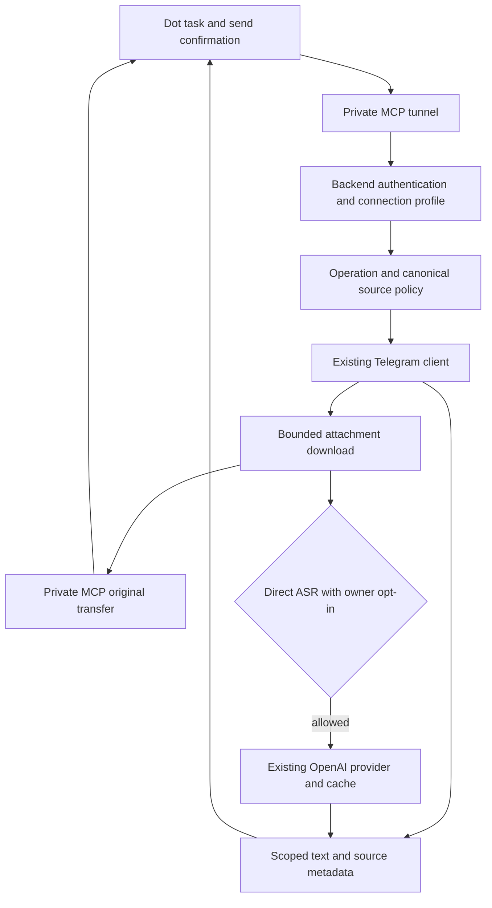
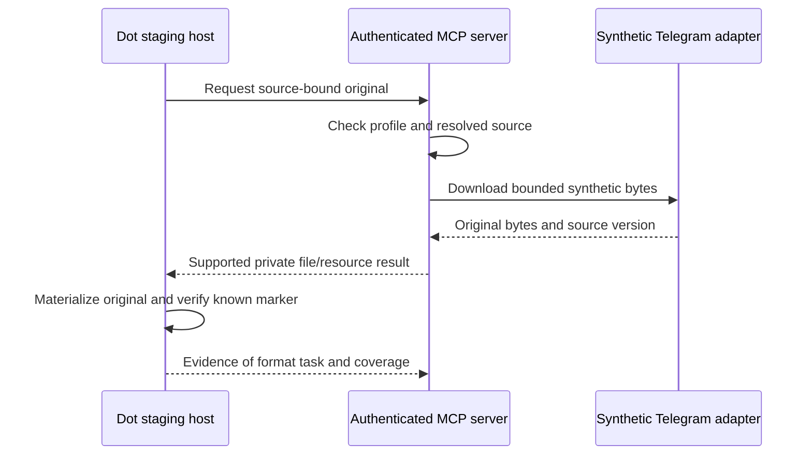
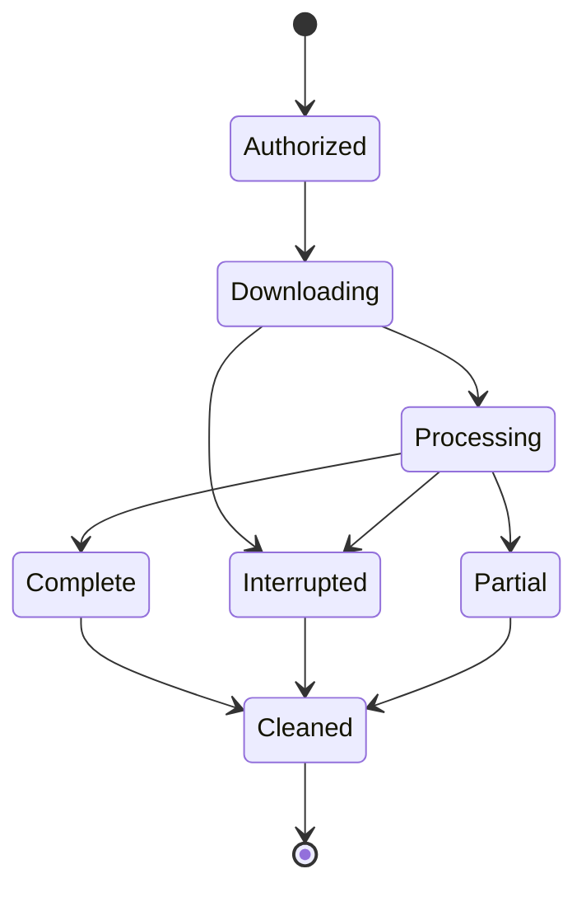
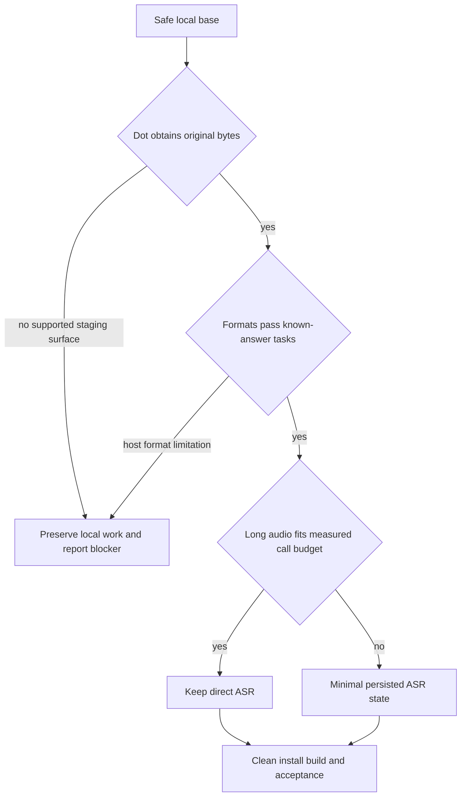

# Telegram Direct Tasks for Dot - Plan

## Goal Capsule

- **Objective:** A self-hosted user can give Dot a Telegram task and receive the result without manually moving messages or attachments between applications.
- **Means:** Reuse the existing Telegram tools and ASR stack, with connection-bound permissions and original-file delivery to Dot (KTD1–KTD6).
- **Authority:** Current user instructions, then the Product Contract below, then the Planning Contract, then unit-local detail. The source is the workspace's 2026-11-10 `PLAN.md` and `PRD.md`; their product scope is preserved here. Private workspace operations documents are not publication inputs.
- **Execution profile:** One implementation branch from production base `0246df8c3c99818d68f50e8591b2d3dda8363f81`, one PR covering stages A–D. Existing Events PR #1 remains separate and unmerged.
- **Stop conditions:** A settled decision proves infeasible, a required verification is refused, or the original-transfer gate cannot be completed through a supported Dot staging surface. Preserve completed local work and state the exact missing evidence; do not replace Dot analysis with server parsers.
- **Ownership:** The implementation run completes local verification and PR delivery. Deployment, real Telegram sends, use of personal audio, and merge require the corresponding explicit authority and are not granted by this plan.

---

## Product Contract

### Summary

Deliver the first self-hosted release for direct Telegram tasks across the PRD formats. The server supplies scoped Telegram operations, original attachments, and requested audio transcription. Dot analyzes documents, tables, images, scans, and video.

### Problem Frame

The current connection exposes six tools and can read messages and transcribe voice messages, but does not establish that Dot receives original attachments. Existing file-path and chat-scope assumptions also prevent safely expanding that surface to other clients and formats.

### Requirements

**Access and ownership**

- R1. Each installation uses its owner's existing Telegram session, with no second simultaneous client sharing the same authorization key.
- R2. Credentials select a server-owned connection profile with explicit chat and operation scope; unconfigured or invalid credentials fail closed.
- R3. Permission checks use typed canonical peer identities and validate the resolved source before Telegram content access and before returning cached or exported data.
- R4. Reading, attachment retrieval, external ASR, sending, and other mutations are separate permissions; default installation scope is Saved Messages or an explicit list, while all-chats access requires an explicit owner choice.
- R5. Client roots may narrow server file boundaries but cannot expose the session, environment, source code, or arbitrary server paths.

**Direct tasks and files**

- R6. Dot can use scoped history, search, unread, message context, reply/topic/forward/album relationships, and source links without implicitly marking messages read.
- R7. Dot obtains original attachment bytes for images, text and scanned PDF, DOCX, XLSX, voice, video notes, ordinary audio, long calls, and video; results disclose unsupported size/codec/encryption and any omitted pages, sheets, or time ranges.
- R8. Dot performs document, spreadsheet, image, scan, and video analysis; the server does not add format parsers, OCR, or video analysis to compensate for a transfer failure.
- R9. File handling bounds actual downloaded bytes, serialization, disk, time, and cleanup, without trusting Telegram metadata or a caller-supplied path.

**ASR and sending**

- R10. An explicit owner setup opt-in permits official OpenAI ASR for subsequent direct tasks in the allowed scope; API-key presence, history reads, and background events do not grant or trigger it.
- R11. OpenAI is the primary ASR engine, with native Telegram fallback only for supported media and available native capability; results identify the engine, fallback reason, and completeness.
- R12. Long audio preserves part order and offsets and reports partial/interrupted work honestly; an ambiguous external POST is not retried blindly into another paid request.
- R13. Each send requires Dot confirmation of the exact recipient, text, and reply target, with cancellation causing no send and an unknown send result checked against history before repetition.

**Distribution**

- R14. Session and credentials are created privately outside checkout/build/media roots, never printed by normal onboarding, and excluded with caches, logs, backups, SQLite sidecars, and personal transcripts from distributed artifacts.
- R15. A second user can install the pinned supported build without editing Python, with real CI, a successful image build, documented revocation/update/rollback, and the format acceptance evidence required by R7.
- R16. Changes preserve the existing private connection and neighboring services; only the addressed instance may be deployed or rolled back under separately granted deployment authority.

### Key Decisions

- **One owner per installation** (session-settled: user-directed — chosen over a shared multi-user service: each user controls their own session). Governs R1, R14.
- **Server hands and ASR, Dot analysis** (session-settled: user-directed — chosen over VPS parsers/OCR/video analysis: Dot performs content reasoning). Governs R7, R8.
- **Direct tasks before observation** (session-settled: user-directed — chosen over bringing the Events branch into v1: the first release must cover direct tasks across the PRD formats). Governs R6, R7, R15.
- **One setup ASR consent** (session-settled: user-directed — chosen over consent for every recording and Telegram-primary transcription: explicit owner opt-in enables requested OpenAI-first ASR). Governs R10, R11.
- **Dot confirms each send** (session-settled: user-directed — chosen over an independent approval server: the trusted-client credential is the accepted boundary). Governs R13.

### Scope Boundaries

Events/watch delivery is deferred until after v1. Its existing branch and findings remain separate follow-up work.

No shared SaaS, second session client, new agent platform, notification system, large ACL framework, generic queue, Redis, approval server, or unsolicited upstream tool expansion is included. Dot does not expose edit/delete/mark-as-read, arbitrary uploads, server-path sends, account changes, or bulk mutations.

Considered and not built: a public media endpoint as the initial export route, because private MCP byte transfer must be tested first; reconsider only if a supported host transfer mechanism requires it. Persistent ASR jobs and media conversion are conditional work in U6, justified by measurements rather than added in advance.

### Acceptance Examples

- AE1. Covers R2–R5: a second profile, an untyped peer with the same number, a widened client root, or a revoked scope yields no content, metadata, cache hit, or exported bytes.
- AE2. Covers R7–R9: a synthetic DOCX table and multi-sheet XLSX reach Dot as accessible originals, and Dot answers embedded known-answer questions while identifying the source and coverage.
- AE3. Covers R10–R12: history reading makes no ASR request; a permitted direct audio request after opt-in uses OpenAI and identifies any native fallback or unprocessed range.
- AE4. Covers R13: rejecting the displayed recipient/text/reply proposal causes zero Telegram sends; an uncertain transport result does not produce an automatic duplicate.

---

## Planning Contract

### Baseline and Reuse

The working Events branch was `45080a8` when this run began; PR #1 was verified open and unmerged. Its `runtime.py`, `media.py`, and `transcription.py` match production base `0246df8`; reuse those base implementations rather than merging Events. Upstream fetched for this run is `6cc2153`; inspect and selectively port security commit `8ddc31c` instead of adopting the whole upstream delta.

Existing seams are `runtime.py` identity/access/path helpers, `transport/http.py` SDK compatibility, `tools/media.py` atomic staged download and image tools, `tools/messages.py` context/transcribe/send, and `transcription.py` provider/cache/concurrency handling. The production wrapper's portable behavior may be extracted, but its personal constants must not enter Git.

### Key Technical Decisions

- KTD1. **One shared source policy at the resolution boundary.** Implement R2–R5 in a small server-owned profile/policy layer reused by the Dot wrapper, global result filtering, ASR, and export retrieval. Preserve the public core's supported tools; do not rely only on hiding names. `8ddc31c` fixes typed allowlist parsing, but `_resolve_with_retries` can resolve an ambiguous input to another peer type, so `_resolve` also requires a final canonical-source check.
- KTD2. **Independent HTTP backend authentication before MCP dispatch.** Reuse SDK Host/Origin protection and the existing transport compatibility patch, with the backend credential selecting the profile outside tool arguments. One credential scheme may satisfy both authentication and profile selection; a second application token is not required. Official tunnel-client supports origin-bound `mcp.extra_headers`, so a dedicated header is a candidate independent of tunnel access. Forwarded headers can override static values, so duplicate/override handling must fail closed. Verify the installed binary before relying on this configuration. This implements R2 and R16 without adding OAuth.
- KTD3. **Server-owned filesystem boundaries.** Correct the current root logic, which lets client roots replace server roots, to enforce their intersection. Download/export accepts source identity rather than arbitrary server file paths, uses bounded temporary storage, and cannot reach session/env/code. This implements R5, R9, R14.
- KTD4. **Private original transfer before format claims.** Start with a bounded MCP resource/blob result over the existing private transport, reusing the downloader. The MCP spec supports binary resources but leaves host integration to the application. Establish separately that the local SDK transports exact bytes and that Dot materializes and analyzes them. A server path, URL display, or local mock does not satisfy R7.
- KTD5. **Connection and source checks precede every ASR cache result.** Reuse `transcribe_voice` and the HTTP provider, adding ordinary audio to the same path. The cache identity includes account, canonical peer, message, attachment version, provider/model, and material options, with explicit text retention. Retrieve and validate current source before cache lookup and recheck permission before result return. This implements R3, R10–R12 without a second ASR stack.
- KTD6. **Measured long-audio execution.** Send at most 24,000,000 bytes per OpenAI part, below the documented 25 MB upload limit. Use streamed bounded input and one conversion operation at a time only if required. A converter runs without session mounts, secret environment, network ingress, or unbounded resources. Add minimal SQLite job state only after measured work exceeds the supported call window; do not use progress as a timeout extension. This implements R9 and R12.
- KTD7. **One pinned private installation.** Use one lock and one sanitized `deploy/dot/` profile with the current transport fix, non-root user, resource limits, loopback binding, and default-off observation. Build and inspect the distribution rather than trusting ignore files alone. This implements R14–R16.

### High-Level Technical Design

The component and data boundary for KTD1–KTD5:

The original-transfer protocol gate for KTD4:

The execution and cleanup lifecycle for KTD4–KTD6:

Decisions that constrain execution, with no automatic architecture expansion:

### Assumptions

- A separate synthetic staging connection can be investigated within implementation verification; none is currently established. The available six-tool My Telegram connector has no original-export/resource-registration surface. U4 must report a precise blocker if no supported staging path is available under current authority.
- Current tunnel documentation specifies a 10 MiB complete serialized request/response and a 120-second absolute deadline including queue time. These are documented transport constraints, not measured deployment guarantees. Base64 payloads have less than 7.5 MiB raw capacity after overhead.
- General source size, duration, codec, and conversion limits remain execution measurements. Unsupported input must produce an explicit limit result, not a claim of complete processing.

### System-Wide Impact

Runtime policy changes reach direct tool calls, entity resolution, global searches, cached transcripts, and resource retrieval. Concurrent profiles must not inherit one another's permissions. Onboarding and ignore-rule changes affect CLI output and artifact contents. Existing legitimate `transcribe_voice` callers remain compatible, while the Dot profile exposes only its explicit stable tool allowlist.

### Sources

- Product origin: workspace `PLAN.md`, `PRD.md`, and 2026-11-10 security audit. Their product meaning is preserved; private operating values are intentionally excluded.
- [Existing Events PR #1](https://github.com/serg-shcherbak/telegram-mcp/pull/1) remains separate from this branch.
- [Upstream security fix](https://github.com/chigwell/telegram-mcp/commit/8ddc31c) informs U1 and must be adapted against the selected base.
- [Secure MCP Tunnel limits](https://developers.openai.com/api/docs/guides/secure-mcp-tunnels#limits) determine U4/U6 transport verification.
- [Official tunnel-client static headers](https://github.com/openai/tunnel-client/blob/master/docs/configuration.md#static-mcp-headers-optional) informs KTD2.
- [MCP resources](https://modelcontextprotocol.io/specification/2025-11-25/server/resources) establishes binary protocol capability, not Dot materialization.
- [OpenAI file transcription](https://developers.openai.com/api/docs/guides/speech-to-text) informs KTD6 and the configured primary model, initially `gpt-transcribe`.

---

## Implementation Units

### U1. Canonical peer and transport security

**Goal:** Close the reproduced peer-type and HTTP Host/Origin gaps on the production base.
**Requirements:** R2–R4, R16; KTD1, KTD2.
**Dependencies:** None.
**Files:** `telegram_mcp/runtime.py`, `telegram_mcp/runner.py`, `telegram_mcp/transport/http.py`, `tests/test_chat_allowlist.py`, `tests/test_runner.py`, `tests/test_protocol_negotiation.py`.
**Approach:** Selectively adapt `8ddc31c`, omitting dependencies on upstream signed-media work absent from the base. Trace and guard the final entity returned by resolution, as well as the requested ID. Preserve the deployed SDK compatibility behavior.
**Execution note:** Begin with failing regressions for same-number peer types and resolution to an unexpected peer.
**Patterns:** Existing allowlist tests and transport negotiation tests.
**Test scenarios:**
1. A user/channel/group sharing the same bare number cannot inherit another type's permission.
2. A permitted-looking input that resolves to an out-of-scope peer is rejected before content calls.
3. Invalid Host/Origin is rejected while configured private transport and supported protocol versions remain usable.
**Verification:** The targeted regressions and existing identity/transport suites pass on the new base branch. These seams prove server checks, not tunnel forwarding.

### U2. Connection profiles, backend auth, and server roots

**Goal:** Apply one operation/source boundary to manual tools, global results, caches, and exports.
**Requirements:** R2–R5, R9; AE1; KTD1–KTD3.
**Dependencies:** U1.
**Files:** `telegram_mcp/runtime.py`, `telegram_mcp/runner.py`, `telegram_mcp/transport/http.py`, planned `telegram_mcp/access.py`, planned `deploy/dot/dot_server.py`, `tests/test_file_path_security.py`, `tests/test_allowed_roots_env.py`, `tests/test_runtime.py`, `tests/test_runner.py`, planned `tests/test_dot_profile.py`.
**Approach:** Add the smallest immutable profile representation and shared checks needed by KTD1. Bind authenticated requests to their profile before tool/resource dispatch and reject direct invocation of hidden tools. Configure explicit read/attachment/ASR/send scopes without granting read-all to permit a send. Replace client-root substitution, including recovered/error paths, with the boundary in KTD3. Disable baseline ring/debounce producers and unconditional dialog warming in the safe profile by selectively reusing the existing default-off guards. Verify backend header support without reading secret values.
**Test scenarios:**
1. Missing/invalid credentials and duplicate/overridden backend credentials fail before invoking Telegram.
2. Two concurrent profiles return only their allowed sources and cannot select a stronger profile by arguments.
3. Read-only credentials cannot invoke send, ASR, export, or mutation tools directly.
4. A client root containing session/env/code, a symlink escape, and a caller-supplied server path yield no bytes.
5. Scope revocation prevents a subsequent cache/export read, including an already issued resource handle.
6. Revocation during download/provider I/O withholds the final result and stops new parts; data already dispatched externally cannot be recalled.
**Verification:** Real local MCP/HTTP integration exercises the shared boundary, with safe credentials and synthetic data. Existing root tests are intentionally updated where they encoded client-root replacement.

### U3. Private onboarding and artifact exclusions

**Goal:** Create private session/state files and remove known publication leaks.
**Requirements:** R1, R14, R16; KTD3, KTD7.
**Dependencies:** U2.
**Files:** `session_string_generator.py`, `migrate_session.py`, `.gitignore`, `.dockerignore`, `.mcpbignore`, planned `deploy/dot/.env.example`, planned `deploy/dot/Dockerfile`, planned `deploy/dot/compose.yaml`, `tests/test_session_string_generator.py`, `tests/test_migrate_session.py`, planned `tests/test_packaging_security.py`.
**Approach:** Preserve the normal login/migration behavior while creating private directories/files from the outset and avoiding default session-string output. Provide sanitized owner configuration, opt-in explanation, and the minimal frozen-lock container definition reused by U6/U7. Exclude session/env backups and sidecars consistently from Git, Docker, MCP bundles, wheels, and source distributions.
**Test scenarios:**
1. Normal synthetic login/migration emits no session string and creates private files outside media/checkout roots.
2. A failed or cancelled migration preserves the source and does not leave a permissive partial target.
3. A prepared artifact containing synthetic secret-shaped session/env/backup/sidecar files excludes them from every supported distribution.
**Verification:** Onboarding tests, captured-output checks, and built-artifact inspection pass without a real Telegram login or personal session.

### U4. Original-file transport and Dot acceptance gate

**Goal:** Prove that Dot receives usable originals through the supported private route.
**Requirements:** R3, R5, R7–R9; AE1, AE2; KTD3, KTD4.
**Dependencies:** U2, U3.
**Files:** `telegram_mcp/tools/media.py`, planned `telegram_mcp/attachments.py`, `deploy/dot/dot_server.py`, `tests/test_media_download.py`, `tests/test_photo_tools.py`, `tests/test_photo_source.py`, planned `tests/test_attachment_export.py`, planned `docs/acceptance/dot-originals.md`.
**Approach:** Reuse atomic staged download and existing MCP Image tools. Expose source-bound original retrieval with safe metadata and bounded serialization. Generate small synthetic fixtures with hashes and known markers instead of committing private or large files. Test the candidate resource/blob mechanism with the real local SDK, then the actual Dot staging host.
**Test scenarios:**
1. Exact original hashes survive local MCP transport for image, PDF, DOCX, XLSX, audio, and video fixtures.
2. Actual received bytes exceeding the cap, cancellation, disconnect, expiry, and revoked access cause explicit failure and cleanup.
3. Dot materializes each original and answers known-marker questions; include scanned PDF, DOCX table, multi-sheet XLSX/formulas, album relationships, and video time ranges.
4. A displayed server path/URL or a preview-only result does not mark a format accepted.
**Verification:** Record separate download, local serialization, Dot materialization, and Dot task evidence, including measured limits. If the host path cannot be tested or a required format fails, stop the dependent work and return the exact blocker. No new public route or server parser is enabled as a workaround.

### U5. Scoped manual tools and ordinary-audio ASR

**Goal:** Complete direct context tasks and reuse ASR safely for all supported audio media.
**Requirements:** R3, R6, R10–R13; AE3, AE4; KTD1, KTD5.
**Dependencies:** U4.
**Files:** `telegram_mcp/runtime.py`, `telegram_mcp/tools/messages.py`, `telegram_mcp/tools/chats.py`, `telegram_mcp/transcription.py`, `deploy/dot/dot_server.py`, `tests/test_voice_transcripts.py`, `tests/test_transcription.py`, `tests/test_chat_allowlist.py`, `tests/test_chats.py`, `tests/test_dot_profile.py`.
**Approach:** Open only verified existing context/search/unread tools. Keep nullable unread limits and report incomplete FloodWait traversal. Extend the shared transcribable predicate and provider path for ordinary audio, then implement KTD5. Enforce owner opt-in plus per-profile operation/source scope before download or provider calls. Preserve `transcribe_voice` compatibility and annotate the exact send arguments for Dot confirmation.
**Test scenarios:**
1. History/search/context returns source/topic/reply/forward/album evidence without read receipts or external ASR.
2. No opt-in, wrong profile, or out-of-scope media produces zero external requests, including on a warm cache.
3. Permitted voice, video note, and ordinary audio use configured OpenAI; supported native fallback identifies its cause and engine.
4. Native fallback unavailable for an ordinary file, bad credentials/configuration, or over-limit input yields a specific failure without claiming primary success.
5. Account/model/attachment changes invalidate cache identity, retention expires text, and cancellation cleans temporary input.
6. Synthetic send confirmation cancellation causes zero sends; an ambiguous result is surfaced without an automatic resend. A send-only profile cannot widen its read scope to reconcile history and reports uncertainty when it cannot check.
**Verification:** Existing and added provider/cache/manual-profile tests pass. Per-send live acceptance remains unavailable without an explicitly supplied test recipient and exact text.

### U6. Measured long-audio processing

**Goal:** Handle long recordings within measured resource and transport bounds, with honest partial state.
**Requirements:** R9, R11, R12, R16; KTD5, KTD6.
**Dependencies:** U5.
**Files:** `telegram_mcp/transcription.py`, `deploy/dot/compose.yaml`, `tests/test_transcription.py`, planned `tests/test_audio_limits.py`; only if measurement requires them, planned `telegram_mcp/transcription_jobs.py` and `tests/test_transcription_jobs.py`.
**Approach:** Replace in-memory source download with bounded streaming. Measure synthetic workloads in the documented minimum environment and actual supported call budget. Add only the converter isolation or persistent job state justified by those results, with deterministic part ordering, offsets, cancellation, and restart/error reporting.
**Test scenarios:**
1. Under/at/over part limits are enforced on actual part bytes and preserve transcript order and offsets.
2. Converter timeout, corrupt codec, disk exhaustion, cancellation, and restart do not leak temporary audio or session/secret access.
3. A provider timeout after an uncertain POST does not blindly repeat the charge; incomplete ranges remain visible.
4. If persisted jobs are required, restart exposes interrupted/completed parts and result retrieval without cross-profile access.
**Verification:** Record measured memory/CPU/disk/time and supported source/duration limits. Direct execution remains when it fits; conditional job code is absent otherwise. Personal recordings are not test fixtures.

### U7. Reproducible installation, CI, and release evidence

**Goal:** Make the verified v1 installable by another owner without Python edits.
**Requirements:** R7, R14–R16; KTD7.
**Dependencies:** U3–U6.
**Files:** `deploy/dot/Dockerfile`, `deploy/dot/compose.yaml`, `deploy/dot/README.md`, `pyproject.toml`, `uv.lock`, `README.md`, `.github/workflows/tests.yml`, `.github/workflows/docker-build.yml`, `tests/test_packaging_security.py`, `docs/acceptance/dot-originals.md`.
**Approach:** Keep one supported build/lock and sanitized settings, with independent backend auth, explicit owner ASR consent, private paths, and default-off observation. Exercise a clean install, image build, artifact inspection, and actual Actions runs. Document capability limits, provider cost/consent, credential/session revocation, exact-instance update, and state-compatible rollback. Update workspace status and create a new handoff without publishing private operations material.
**Test scenarios:**
1. A clean isolated installation starts with synthetic configuration and rejects unsafe/missing auth without editing source.
2. Built wheel/source/bundle/image contexts contain no synthetic private files or real operating values.
3. CI discovers and runs the intended test/build workflows; an empty check list does not count as green CI.
4. Configuration inspection preserves non-root operation, loopback binding, and documented resource limits without touching neighboring services.
**Verification:** Full relevant tests, formatting/fatal lint, clean-install smoke, Docker build, artifact scan, and U4/U6 acceptance evidence all pass. Missing daemon or host acceptance is recorded as a blocker to release, never a completed check.

---

## Verification Contract

Use the selected branch's dev environment and the existing project commands: `uv run pytest`, `uv run black --check .`, and the fatal Flake8 selection already defined by its CI. Run the affected suites while implementing each unit, then the full supported suite once the final changes settle. Use the same frozen lock for clean installation and the `deploy/dot/Dockerfile` image build.

Security regressions must fail before the fix and pass afterward. Local SDK/HTTP tests prove server boundaries and exact serialization, while actual Dot/tunnel staging proves materialization, forwarding, and format tasks. Keep those evidence classes separate in `docs/acceptance/dot-originals.md`.

Use synthetic known-answer data only. No personal audio, Telegram mutations, real external ASR upload, production replacement, or second authorized session client is implied by test execution. A real send requires the exact separately authorized recipient/text/reply. If a necessary staging route or external-provider test cannot be completed under current authority, preserve local evidence and return the named blocker.

Before shipping, inspect the final diff and packaged contents for session material, personal identifiers/addresses, and source data. Record exact commands, result counts, branch/commit, and observed limitations in the run evidence; historical test counts are not proof of the new code.

---

## Definition of Done

- U1–U3 negative and compatibility checks pass on the independent production-base branch.
- U4 proves R7 through the actual supported Dot/private connection across all requested formats, with byte and known-answer evidence.
- U5/U6 meet the direct ASR, consent, cache, fallback, partial-result, and resource contracts with measured limits.
- U7 clean installation, artifact inspection, Docker build, and real CI pass using the pinned build.
- The final diff contains no abandoned experiment, speculative parser/job framework, private content, or personal deployment value.
- The PR states what is verified, any residual findings, and what has not been deployed. No claim of full v1 or safe release precedes all gates above.
